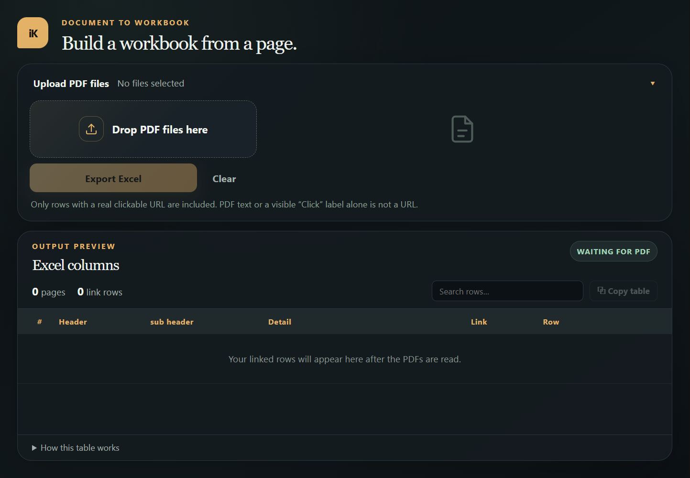
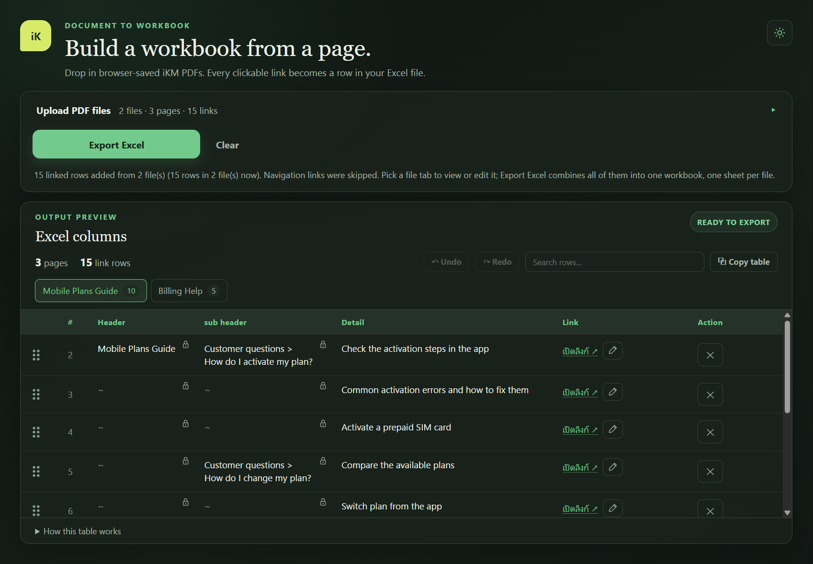
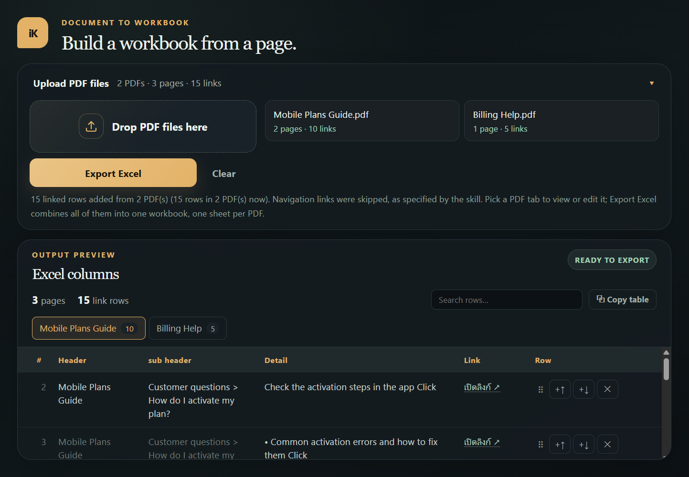
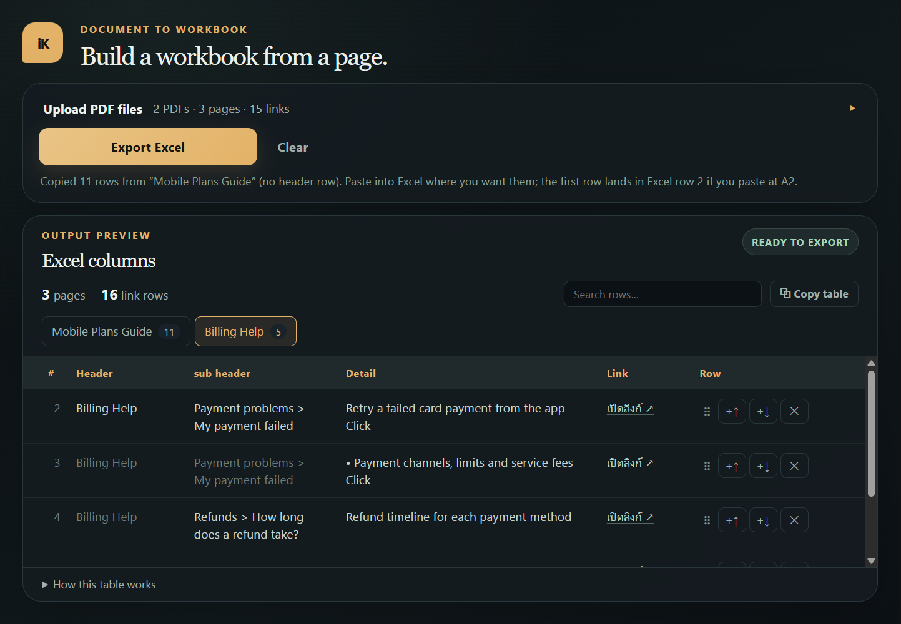
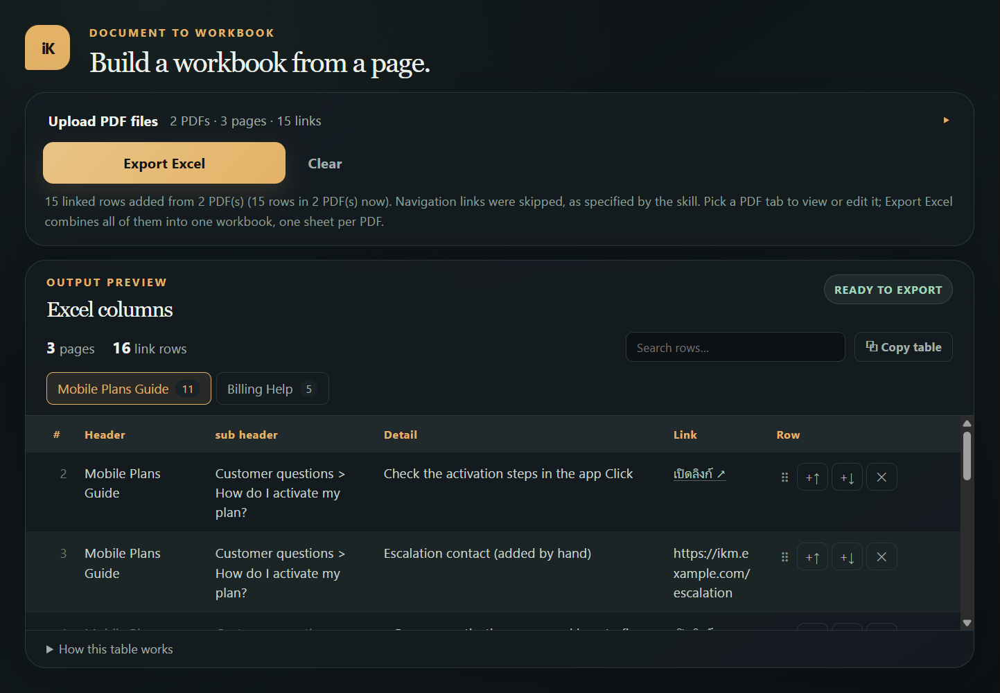
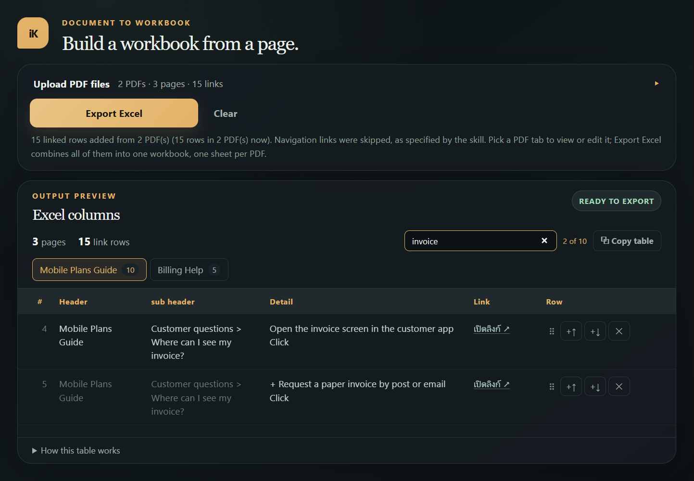
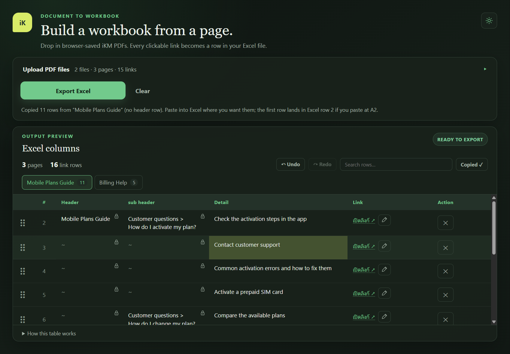

# iKM PDF to Excel

A local web app that turns browser-saved iKM PDFs into an Excel workbook. Every clickable link becomes a row; the rows are laid out in the nine columns of the sample file: **Header, sub header, Detail, Link, Link D, PRC, NLP, common, Web points**. You review and edit the rows in the browser first, then export (or copy) them.

- Only rows with a real clickable URL are kept. Text in the PDF, or a visible "Click" label, is not a URL.
- Several PDF files can be loaded at once. They are exported into **one workbook with one sheet per file**.
- Everything runs on your own computer. The server listens on `127.0.0.1` only.

## Contents

- [Quick start](#quick-start)
- [How to use it](#how-to-use-it)
- [The preview table](#the-preview-table)
- [What ends up in Excel](#what-ends-up-in-excel)
- [Tips and troubleshooting](#tips-and-troubleshooting)
- [Command-line use](#command-line-use)
- [Project layout](#project-layout)

## Quick start

```powershell
python -m pip install -r requirements.txt
python server.py
```

The terminal prints the address to open (default `http://127.0.0.1:8000/`). Set the `PORT` environment variable to use another port; if the port is busy the server tries the next ones. Press `Ctrl+C` in the terminal to stop it.

The theme button remembers your light/dark preference. Browsers with the View Transition API crossfade the whole page over 720 ms, with a gentle rotating/bouncing icon. Reduced-motion preferences disable this animation; other browsers switch themes without the page crossfade.

Requirements: Python with `openpyxl` and `PyMuPDF` (both in `requirements.txt`).



> The screenshots in this README were taken with two made-up sample PDFs ("Mobile Plans Guide" and "Billing Help"), not real iKM content.

## How to use it

1. **Start the app.** Run `python server.py` and open the address it prints (default `http://127.0.0.1:8000/`). See [Quick start](#quick-start).
2. **Save the iKM page as PDF.** In your browser use **Print → Save as PDF**. A screenshot or "Microsoft Print to PDF" does not keep clickable links. Repeat for every page you need.
3. **Add the PDF file(s).** Drag them onto the Upload area, or click it to browse. Only `.pdf` files are accepted, and you can pick several at once.
4. **Wait for the read to finish.** Each file shows its own progress while the server extracts the links. A file that cannot be read is marked **Failed** with the reason, and the other files are still loaded. When done, the upload area folds into a summary such as `2 files · 29 pages · 78 links` and the table appears.
5. **Pick a file tab.** Each PDF gets its own tab with its row count. Click a tab to view or edit that file.
6. **Review and fix the rows** (see [The preview table](#the-preview-table)):
   1. Check **Detail** text and edit it where needed.
   2. Edit **Header / sub header** if a group is wrong (unlock the cell to change just one row).
   3. Open the pencil in **Link** to correct a URL (it must start with `http://` or `https://`).
   4. Reorder with `⠿`, delete with `✕`, or add a row with the circled `+` between rows.
   5. Use **Search rows…** to find a row; use **Undo / Redo** (Ctrl+Z / Ctrl+Y) if you change your mind.
7. **Add or remove files if needed.** Open the **Upload PDF files** panel to add more PDFs, or press the trash-can button on a file's card to remove it and its rows (see below).
8. **Get the result**, either way:
   - **Export Excel** downloads one `.xlsx` (one sheet per PDF). If any hand-added or edited URL is empty or invalid, a **Check rows before export** dialog lists them; fix them and export again.
   - **⧉ Copy table** copies the open tab so you can paste it into Excel yourself (see [Copy table](#copy-table)).
9. **Start over (optional).** **Clear** removes every file and row after a confirmation.



### Adding more files later

Open the **Upload PDF files** panel again (click its header) and drop more files. They are **added** to the ones already loaded and nothing you edited is lost. A file with the same name as one already loaded becomes `name (2)`. Wait for the current read to finish before adding more. **Clear** removes everything and asks for confirmation first.

### Removing one file

In the opened **Upload PDF files** panel every file has its own card with a trash-can button. It removes that file and its rows (its tab and Excel sheet) and leaves the other files untouched. If the file has rows, a **Remove this file?** dialog asks you to confirm first, because your edits to those rows are lost. The buttons are disabled while files are being read, and Undo / Redo history is reset after a removal.



### Several source files

The preview shows one **tab per file** with its row count. Click a tab to view or edit that file. The tabs only change what you see: **Export Excel** always writes every file, each on its own sheet.



## The preview table

| Column | What it shows |
| --- | --- |
| **#** | The row number as it will be in the Excel sheet. The header row is row 1, so the first data row is **2**. Each tab counts on its own and the search never renumbers rows. Web only, never exported. |
| **Header** | The page title. Written once per group in Excel. Grey text means read-only in the preview (Auto repeat or manually Locked). |
| **sub header** | Section / problem label. Repeated values are omitted in Excel; the preview shows the value on every row. |
| **Detail** | The link's text. |
| **Link** | `เปิดลิงก์ ↗` opens the current URL; the pencil opens its editor. In Excel this cell reads `URL` and carries the hyperlink. |
| **Action** | Row tools (below). |

What you can edit:

- **Detail** on every row.
- **Header / sub header** according to each cell's mode (below).
- **Link** on every row: click the pencil to edit the full URL in a dialog, then Save. New destinations must be valid `http(s)` URLs. Cancel or Escape discards the draft. PDF rows also offer **Use original URL**, which fills the original destination into the editor; Save applies the restoration. Originals are preserved even if they use another scheme. Saving and restoring support Undo / Redo; Copy / Export use the current saved URL.
- Cells accept **plain text only**: pasted formatting is dropped, line breaks become spaces, and `Enter` just leaves the cell.

Each **Header / sub header** has a top-right icon toggling **Locked / Auto (closed lock) ↔ Unlocked (open lock)** independently. All rows start in Locked / Auto: values repeating the preceding row in the same sheet are grey/read-only; group headings remain editable and editing them updates consecutive matching Auto cells below, skipping Unlocked cells. The closed lock means automatic grouping, not that every cell is read-only. Unlocked allows editing only that cell. Switching back to Locked / Auto keeps edits and recalculates whether the cell repeats; search does not change which row is its predecessor. Modes survive filtering, reordering and tab changes but reset on reload with the loaded data. Detail stays editable; URL editing uses the pencil dialog. Modes do not affect Copy / Excel layout: repeated headings are still suppressed automatically.

New hand-added rows inherit Header / sub header from the preceding row in the same sheet, including hidden rows when searching. When inserted before the first row, they inherit that first row's headings instead. They start in Auto and show grey `~` for repeated headings; Copy / Excel leave those repeated cells blank. Group edits also update matching Auto headings on hand-added rows. To use a different heading, unlock just that cell and enter it; a genuinely new heading is included in Copy / Excel.

Row tools (drag handle in its own first column, before **#**; delete in **Action**):

Repeated non-empty Header / sub header values in Locked / Auto appear as a grey `~` in the preview. Hover over the marker to see the full heading, or unlock the cell to edit it. Empty headings stay blank. This marker is display-only: search still matches the full stored heading, and Copy / Excel never substitutes `~` for it.

- `⠿` drag to reorder · `✕` delete. To insert a row, click the circled `+` at a row boundary, including before the first or after the last row. The green line is a position indicator only and does not accept clicks. Tab to the insertion button and press Enter or Space for keyboard use; touch screens always show the controls. When searching, insertion is immediately before the indicated row (or after the last visible row), without moving hidden rows.
- A row you add can have its own Header, sub header, Detail and **URL**, which must start with `http://` or `https://`; rows with an empty or invalid URL block the export until you fix or delete them.

When Export finds invalid URLs in hand-added rows or edited PDF destinations, a dialog lists all issues across all tabs, including rows hidden by search. Each entry shows the sheet, Excel row number, and whether the URL is empty or invalid. **Go to URL** opens the correct tab, clears search and opens the URL editor. Fix or delete the listed rows and export again; no export request is sent while issues remain. Unmodified or restored PDF destinations are preserved and are not subject to the edited URL rule.



Toolbar above the table:

- **Undo / Redo** reverses text edits (one editing session per focused cell, including grouped changes), row insertion/deletion/reordering, and Header / sub header mode changes. Use Ctrl+Z / Cmd+Z to undo and Ctrl+Y or Ctrl+Shift+Z / Cmd+Shift+Z to redo. Search inputs keep their normal text shortcuts. New edits discard redo history. History stays in memory across tab/search changes and resets when PDFs are uploaded, a file is removed, Clear is confirmed, or the page reloads. Uploads themselves are not undoable; history controls are disabled during reading.
- **Search rows…** filters the open tab by Header, sub header, Detail or URL and shows `N of M`. Matching visible text is highlighted in browsers supporting the CSS Custom Highlight API (case-insensitive, literal search). It only changes what you see: export and copy always include every row. Rows you just added stay visible while you search.
- **⧉ Copy table** (see below).



Describing links that have no text:

- A bare **Click / คลิก** button is described from the date or `Week N` label and the card text above it, and the sub header is the month heading.
- A link that is only a **picture** is described by its image name, read from the PDF's tags (the file name you would get from "Copy image address"), plus any text inside the clickable area. A PDF does not keep the full image address (`https://ikm.ais.co.th/ikm-file/…`), so that name is what you get; you can type the address into Detail yourself.
- Thai text is kept exactly as it was extracted.

### Copy table

**⧉ Copy table** copies the open tab laid out exactly as the Excel file would be, **without the header row**, so you can paste it straight into your own sheet:

- Header once per group, sub header only when it changes, `URL` hyperlink in Link, the last four columns blank.
- Paste at `A2` if you want the rows to line up with the `#` numbers.
- Excel receives a rich (HTML) copy, so the `URL` hyperlinks survive. Plain-text editors receive tab-separated text with the real URL in the Link column.



## What ends up in Excel

- **One sheet per PDF**, named after the PDF. A repeated name gets ` (2)`, and Excel limits sheet names to 31 characters.
- **Nine columns:** Header, sub header, Detail, Link, Link D, PRC, NLP, common, Web points. Only **Link** is hyperlinked (the cell reads `URL`). Detail is plain text. Link D, PRC, NLP, common and Web points are left blank for you to fill in.
- **Header** is written once per group and **sub header** only when it changes.
- **Every row is kept**, including rows that look identical. The `#` number on the web is the Excel row number.
- **Formula safety:** Excel reads a cell that starts with `=`, `+`, `-` or `@` as a formula, so Header, sub header and Detail that start with one of these get **one space in front** (for example ` + บันทึกข้อมูล`). This applies to both Export Excel and Copy table; the preview keeps the original text.
- **File name:** the PDF's name plus `_links.xlsx` (for several PDFs `ikm_pages_links.xlsx`), cleaned of characters Windows does not allow and limited to 31 characters including the extension.

## Tips and troubleshooting

- **"A bundled iKM file extractor or the Excel builder is missing from scripts/"** on start-up: one of the extractor scripts or `scripts/build_xlsx.py` is missing.
- **Zero rows:** the PDF may have been printed as an image. Save again from the live page and make sure the PDF keeps clickable links.
- **Weird or old behaviour after changing code:** make sure only one `python server.py` is running. On Windows a second server can share the same port and answer some requests, so stop old ones before restarting.
- **Slow or large files:** PDF reading time depends on the page count. The progress bar moves to about 95% while the server works and finishes when it replies.
- The page itself does not scroll; only the table does. If your window is very short, the page scrolls as a last resort.

Run the automated checks with `python -m unittest discover -s tests -v`. For extraction changes, also convert a real browser-saved PDF, then export and open the workbook.

## Command-line use

The server calls these scripts, and you can run them yourself:

```powershell
python scripts/extract_pdf_links.py page.pdf --out rows.json [--header "Page title"] [--include-nav]
python scripts/build_xlsx.py --json rows.json --output result.xlsx [--fill-down] [--link-mode label|url] [--link-label TEXT]
python scripts/build_xlsx.py --json more.json --append result.xlsx
```

- `extract_pdf_links.py` writes `[{header, sheet?, rows: [{sub_header, detail, url, page}]}]` and skips navigation links (`#Home`, `#P1`…) unless `--include-nav`.
- `build_xlsx.py` accepts the same JSON. A `sheet` value puts the page on that sheet; pages with different `sheet` values become separate sheets. `--append` adds rows to an existing workbook and skips rows already in it.
- On a Windows console, set `$env:PYTHONIOENCODING = "utf-8"` first so Thai text prints correctly (the server does this for you).

## Project layout

| Path | Purpose |
| --- | --- |
| `server.py` | Serves the page and two endpoints: `POST /api/convert` (PDF files → rows, tagging each file as a sheet) and `POST /api/export` (reviewed rows → `.xlsx`, base64) |
| `scripts/extract_pdf_links.py` | Reads link annotations, text and image tags from a PDF (PyMuPDF) |
| `scripts/build_xlsx.py` | Writes the workbook (openpyxl), one sheet per `sheet` |
| `index.html`, `styles.css`, `script.js` | The browser interface: upload panel, preview table, tabs, search, copy, export |
| `docs/images/` | Screenshots used in this README (taken with made-up sample PDFs) |
| `requirements.txt` | `openpyxl` and `PyMuPDF` |
